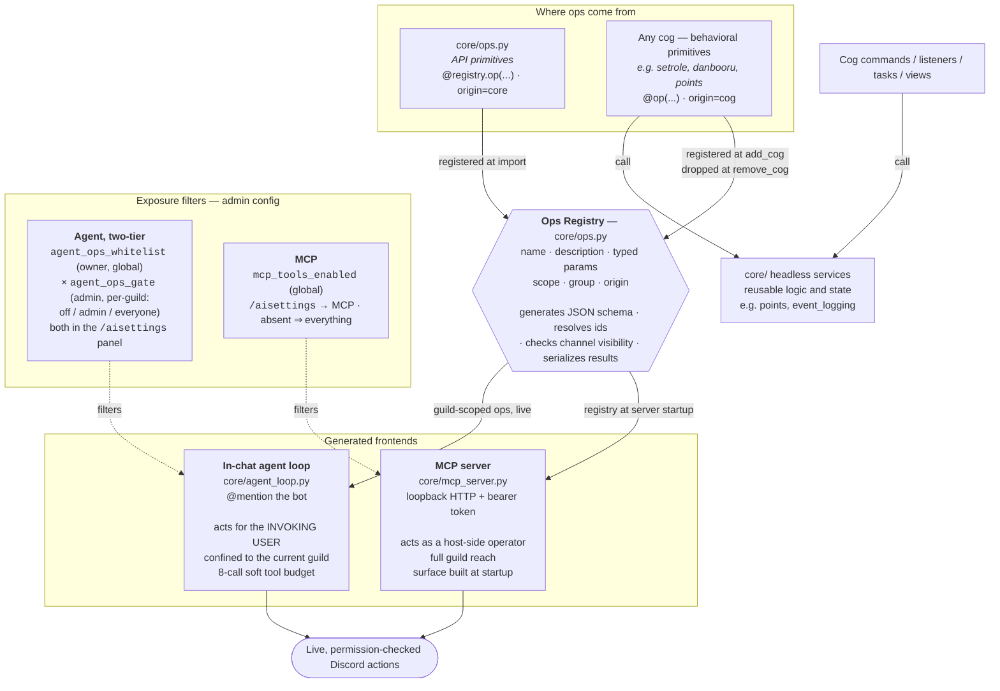

# Architecture: one ops layer, several frontends

Discord actions the bot can take on someone's behalf are **ops**: declared
once in a registry with a name, a description and typed parameters. The in-chat
AI agent, the MCP server and the `/aisettings` panel are all generated from
that declaration, so there is no per-frontend plumbing and no hand-maintained
tool list.

Two kinds of op share the registry:

- **API primitives**: raw, one-to-one Discord actions declared in
  `core/ops.py` with `@registry.op(...)`.
- **Behavioral ops**: capabilities a cog adds with `@op(...)` on one of its
  methods (set up an emoji role toggle, run a rating-filtered image search).

Both have the same shape and calling convention. Cog ops register when the cog
loads and unregister when it unloads, all or none.

**Features live in `cogs/`; reusable implementations live in `core/`.** Each
cog owns its commands, listeners, tasks, views and ops. Cogs do not import
other cogs. The cog set is fixed at boot: `!cogs`, `!disable` and `!enable`
edit the global `disabled_cogs` list and a restart applies it. Disabling a cog
removes its commands, listeners, tasks and tools; saved settings and anything
already done in Discord stay. Only `control` and `admin` cannot be disabled.

## Who can use an op

An op declares **no permission level**. Access is configuration:

1. **Whitelist** (`agent_ops_whitelist`, global): the bot's superadmin picks
   which ops the chat agent may ever be given. Everything is off until then.
2. **Per-guild gate** (`agent_ops_gate`): each server's bot admins set every
   whitelisted op to **Off**, **Admin** or **Everyone** for their server. Off
   applies to everyone, superadmins included.

Both live in `/aisettings`. The model is only given the tools the person
talking to it may use, and nothing about access is written into a tool
description. It calls the tool; if Discord refuses, it gets Discord's error and
explains it.

An op runs with **the bot's** Discord permissions, on behalf of the person who
asked. Setting an op to Everyone lets every member do that through the bot,
which is the operator's call to make. For ops that can hand out access or do
lasting damage (role grants, bans, purges, webhooks), the panel asks for a
typed confirmation before they are first opened to Everyone. That prompt is
the only thing the marker does.

What still applies on every call: the agent is confined to the current server,
it cannot act on channels or private threads the invoking user cannot see, it
cannot read history the user cannot read, and file paths must be inside the
server's media library.

The MCP surface is separate: a host-side operator with the bearer token reaches
every guild the bot is in, filtered only by `mcp_tools_enabled`. See
[security](security.md).
